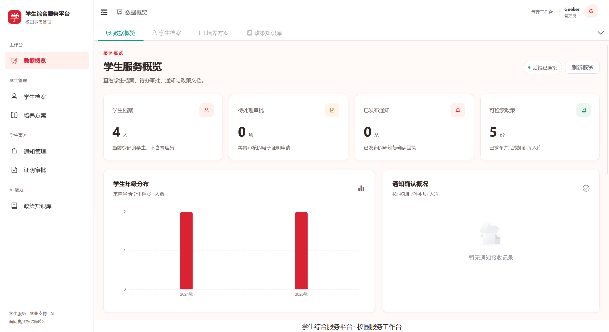
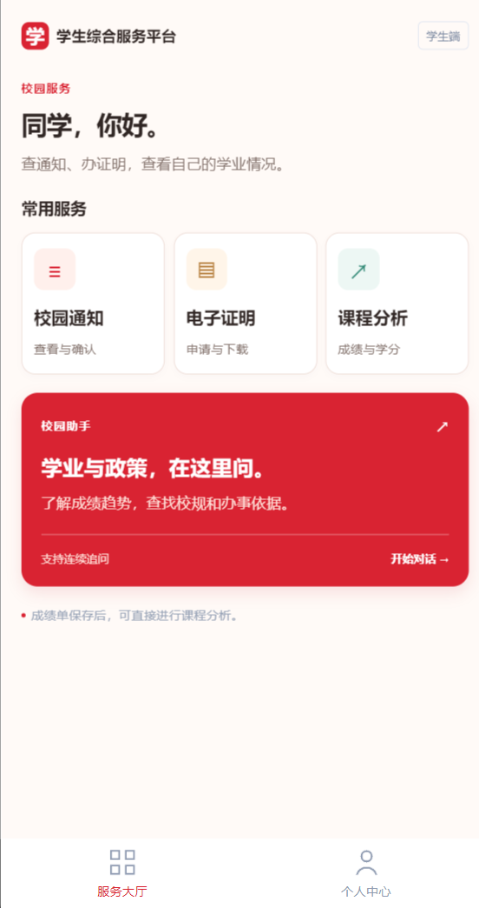
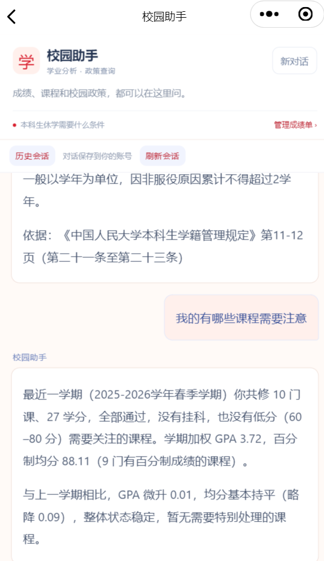
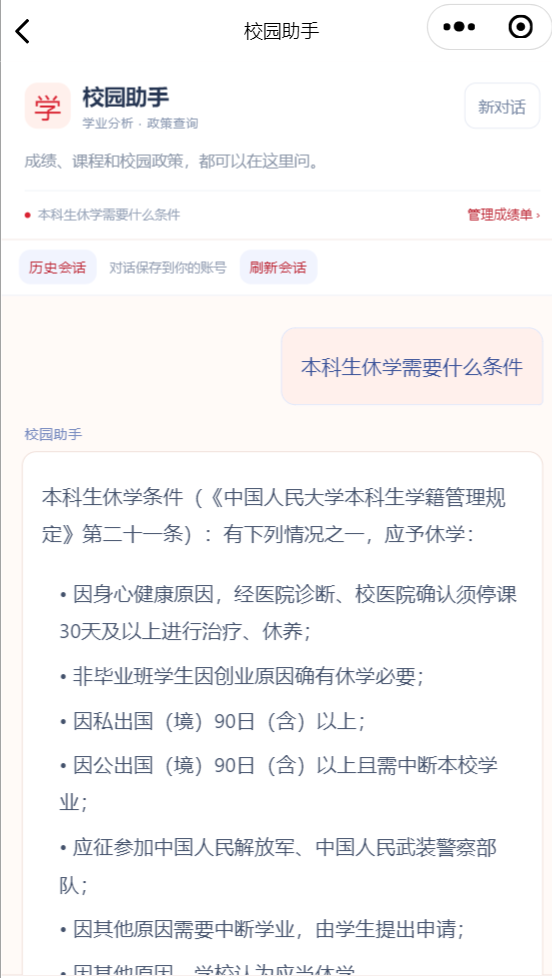
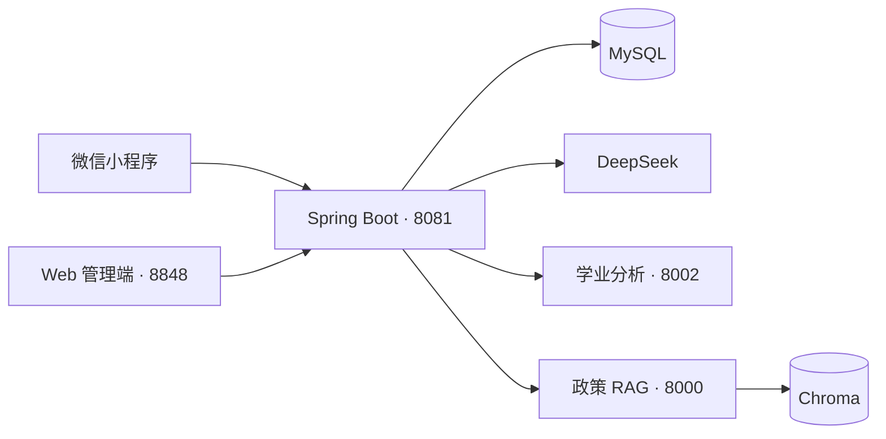

# 学生综合服务平台

基于微信小程序和 Web 管理端的校园服务项目，提供学业与政策助手、成绩单分析及日常学生事务办理。

## 界面预览

Web 管理端：学生档案、待办审批、通知与政策概览。



小程序首页、学业问答和政策问答：

<p align="center">
  
  
  
</p>

## 功能

- **校园助手** 在同一对话中查询学业与校园政策，模型按问题选择 Academic Skill 或 Policy Skill，支持多轮追问、历史会话和执行进度。
- **成绩单分析** 上传并保存 PDF，结合年级、专业匹配培养方案，统计 GPA、学分、未通过课程和核心课程缺口。
- **政策知识库** 管理端上传、发布政策后异步入库，校园助手检索政策原文并附来源和页码。
- **学生事务** 学生档案维护、培养方案管理、通知发布与确认、电子证明申请与审核下载。

## 技术实现

| 模块 | 技术栈 | 职责 |
| --- | --- | --- |
| `backend` | Java 17、Spring Boot、JdbcTemplate、MySQL | 业务接口、JWT 鉴权、会话存储与 Agent 编排 |
| `python-services` | FastAPI、LangChain、Chroma、本地 Embedding | 成绩单解析、学业统计和政策检索问答 |
| `web-admin` | Vue 3、TypeScript、Vite、Element Plus | 管理后台 |
| `miniprogram` | 微信小程序原生框架 | 学生端 |



Single Agent 在 Java 中执行 Tool Calling 循环，使用两个 Skill：

- Academic Skill：资料检查、学业评估、近期课程、成绩趋势四个只读工具。
- Policy Skill：`search_policy_documents` 检索已发布且可用的政策，返回原文、来源和页码。

模型选择需要的工具并组织回答。Java 校验 JWT 和会话归属，限定政策检索范围；Python 复用现有成绩统计、向量检索与重排。政策查询不需要成绩单，也不在 Python 额外调用一次模型。两份提示词在 `backend/src/main/resources/agent/skills/`，修改后重启后端。

会话按登录学生归属保存。历史用于理解追问，当前学业数据由工具读取。同一次请求共享分析快照，多个工具复用一次解析结果。小程序通过 NDJSON 展示模型请求、工具执行和回答完成进度。

## 本地运行

需要 Java 17、MySQL 8、Python 3.11+、Node.js 18+、pnpm 9+ 和微信开发者工具。下面使用 Windows PowerShell，安装命令从项目根目录执行。

### 初始化

首次建库执行 [init-mysql.sql](backend/docs/sql/init-mysql.sql)。该脚本会删除并重建 `student_platform`。

```powershell
python -m venv python-services/.venv
.\python-services\.venv\Scripts\python.exe -m pip install -r python-services/requirements.txt
Copy-Item python-services/.env.example python-services/.env
Copy-Item backend/src/main/resources/application-example.properties backend/src/main/resources/application.properties
Copy-Item backend/local-config.example.json backend/local-config.json
```

填写两个配置文件。

| 文件 | 配置内容 |
| --- | --- |
| `backend/local-config.json` | MySQL 连接、账号、密码及至少 32 字节的 `JWT_SECRET`。首次创建管理员时添加 `ADMIN_BOOTSTRAP_PASSWORD`，账号默认为 `admin` |
| `python-services/.env` | `DEEPSEEK_API_KEY`、`DEEPSEEK_BASE_URL`、`DEEPSEEK_MODEL`，供政策问答和学业 Agent 共用 |

政策向量使用本地 `BAAI/bge-small-zh-v1.5`，首次启动时下载模型。

安装前端依赖并构建后端。

```powershell
cd web-admin
pnpm.cmd install
cd ../backend
.\mvnw.cmd package
```

### 启动服务

确认 MySQL 已启动，分别从项目根目录打开四个终端。

**政策问答 · 8000**

```powershell
cd python-services
.\.venv\Scripts\python.exe -m uvicorn AIAnalysis:app --host 127.0.0.1 --port 8000
```

**学业分析 · 8002**

```powershell
cd python-services
.\.venv\Scripts\python.exe .\5_pdf_compare.py
```

**Java 后端 · 8081**

```powershell
cd backend
.\start-local.cmd
```

**Web 管理端 · 8848**

```powershell
cd web-admin
pnpm.cmd dev
```

打开 `http://localhost:8848` 登录管理端。后端健康检查为 `http://127.0.0.1:8081/api/health`，两个 Python 服务的接口文档位于各自的 `/docs`。

### 微信小程序

在微信开发者工具中导入 `miniprogram`，填写自己的 AppID，本地调试时关闭合法域名校验。模拟器默认连接 `http://127.0.0.1:8081`。

真机预览时，将 `miniprogram/utils/request.js` 的 `DEFAULT_BASE_URL` 改为电脑的局域网地址，例如 `http://192.168.1.100:8081`，与手机连接同一网络。Storage 中的 `baseUrl` 会覆盖默认地址。

## 测试与评测

后端测试覆盖鉴权、会话归属、工具调用、请求内快照及多用户并发隔离。

```powershell
cd backend
.\mvnw.cmd test
```

从项目根目录运行 Agent 工程回归。

```powershell
.\python-services\.venv\Scripts\python.exe python-services/evaluation/agent/run.py --mode regression
```

学业评测包含 13 项任务，覆盖学业分析、多轮追问、资料缺失、越权和数据更新，保存工具轨迹、回答、耗时及实际 token 用量。运行方法见 [评测说明](python-services/evaluation/agent/README.md)，学业基线记录见 [评测报告](python-services/evaluation/agent/grounding_fix/REPORT.md)。

## 第三方组件

Web 管理端基于 Geeker-Admin，许可证见 [web-admin/LICENSE](web-admin/LICENSE)。
